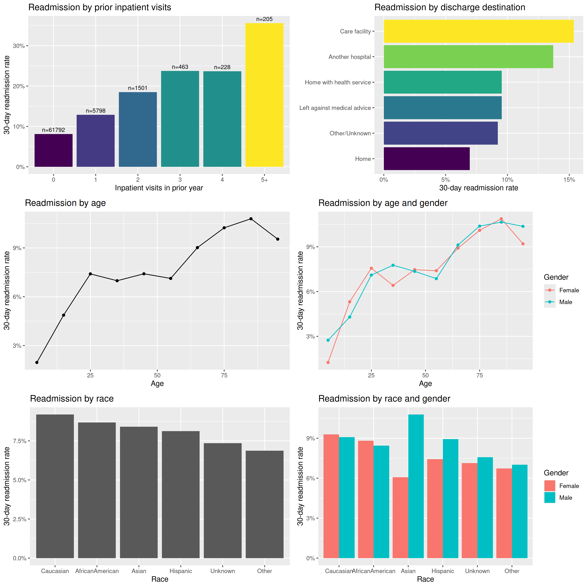
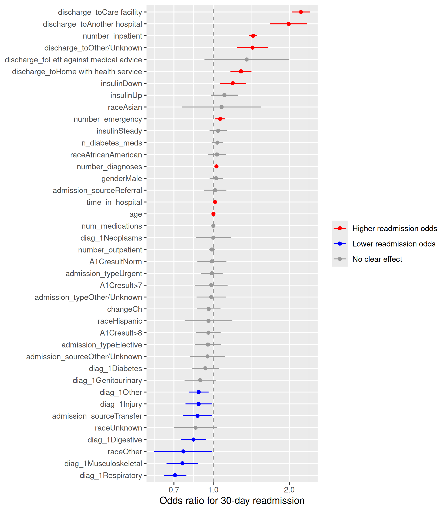
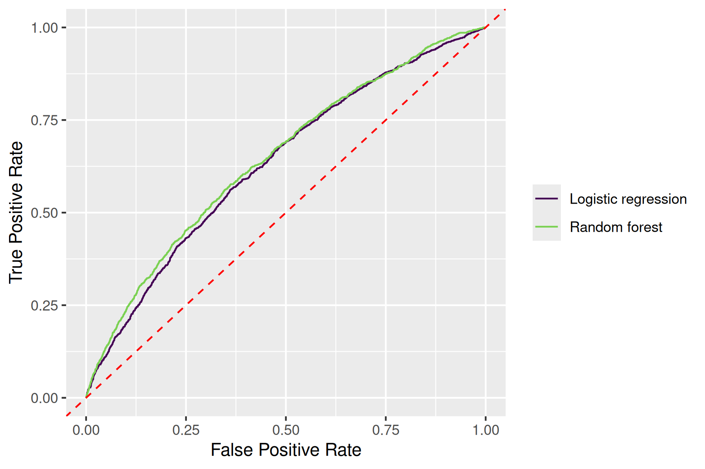

```{r setup, include=FALSE}
knitr::opts_chunk$set(echo = TRUE)
```

## Dataset
This project explores the "Diabetes 130-US Hospitals for Years 1999-2008" dataset from UC Irvine’s Machine Learning Repository. The dataset includes clinical data obtained from the Health Facts database, a large clinical database which collects patient and encounter information from voluntarily participating institutions which utilize the Cerner Electronic Health Record System. This dataset consists only of inpatient diabetic encounters with a length of stay between one and fourteen days and during which lab tests were performed and medication was administered.

## Methods
I used several avenues to explore interesting or unusual patterns in the dataset. As the dataset is designed for a machine learning task with a readmission label, I focused on readmission rates in my analysis. 

#### Exploratory Data Analysis
First, I created some descriptive figures in my exploratory data analysis phase.
```{r edagrid, echo=FALSE, fig.cap="Radmission rates by discharge destination, age, race, and gender.", out.width="80%", fig.align="center"}

```

My preliminary figures yielded several interesting findings. First, the results show that discharge to a care facility was associated with the highest readmission rates, followed by discharge to another hospital. Additionlly, EDA interesting findings Asian and Hispanic males showed significantly more readmissions than their female counterparts, with Asian males experiencing close to double the readmissions of Asian females. This discrepancy does not appear in any other recorded race group.

#### Machine learning methods
I also wanted to apply some machine learning methods to this dataset to take advantage of the pre-labeled dataset. Initially, the readmission column took on three values: readmission within 30 days, readmission after 30 days, and no readmission. I created a binarized version of this label to look only at readmissions within 30 days, combining the no readmission and readmission after 30 days cases.

I first implemented a logistic regression model in R. Predictors for the logistic regression were selected based on clinical relevance and interpretability. Specifically, secondary diagnoses, individual medications other than insulin, and admitting specialty were excluded to keep the model interpretable. I used the coefficients from the logistic regression to generate odds ratios for different variables in the datasest as they relate to readmission.

```{r oddsratios, echo=FALSE, fig.cap="Odds ratios for 30-day readmission from logistic regression, with 95% confidence intervals. Reference groups: discharged home, Caucasian, female, emergency admission, circulatory primary diagnosis, HbA1c not tested.", out.width="80%", fig.align="center"}

```

I also implemented a random forest model and trained it in Python. This time, I fine tuned the model's hyperparameters using 5-fold GridSearchCV for six combinations of min_sample_leaf and max_features, scored with AUC. The model was evaluated in R, and its performance for prediction 30-day readmissions was compared to the logistic regression's using ROC curve.
```{r roc, echo=FALSE, fig.cap="ROC curves for logistic regression and random forest models", out.width="80%", fig.align="center"}

```

## Results

#### Exploratory Data Analysis
My preliminary figures yielded several interesting findings. First, the results show that discharge toa care facility was associated with the highest readmission rates, followed by discharge to another hospital. Number of prior inpatient visits also seems highly indicative of higher readmission rates. Additionlly, EDA interesting findings Asian and Hispanic males showed noticeably higher readmissions than their female counterparts, with Asian males experiencing close to double the readmissions of Asian females. This discrepancy does not appear in any other recorded race group. I decided to investigate this further by looking into health complications related to diabetes for Asian males. Several clinical studies and sources show higher prevalence of type II diabetes at lower BMIs for Asian men and well as higher risk of coronary events for young Asian men. In further analysis, it may be worth looking deeper into potential drivers for the higher readmission rates in Asian males present in the dataset.

#### Machine learning
The odds ratios generated by the logistic regression model also revealed some noteworthy patterns. Despite the dataset's focus on patients with diabetes, factors affecting readmission rates had little to do with diabetes itself. Other than dropping insulin levels during stay, diabetes-related measurements like A1C results, number of diabetes medications, and diabetes as a primary admission code were not associated with noticeably different readmission rates. The odds ratios also showed that the only race group that has a meaningfully different admission rate from the reference group "Caucasion" is "Other." This could also be a skewed result affected by low representation of the race category "Other," or by poor definition of the category.  The most informative features had to do with where the patient was discharged, which reinforces a similar finding in the exploratory data analysis demonstrating discharge to care facility as a strong indicator of higher readmission rates.

Though both the logistic regression and random forest models performed better than chance, they had almost equally unimpressive performance. The logistic regression model achieved an AUC of 0.632, while random forest yielded a slightly higher AUC of 0.645. I had anticipated slightly better performance from the random forest, as it was fine-tuned, used all columns rather than hand picked ones, and can learn more flexible boundaries. This also reveals something about the data: it may suggest that most of the predictive value for readmission in this dataset comes from a few variables like the ones I handpicked for the logistic regression, as adding the rest did not contribute to better performance in the random forest model. This dataset may be better suited to a different machine learning model, or benefit from a more targeted feature selection method.

## Conclusion
Although every patient in this dataset had diabetes, my analysis suggests that 30-day readmission was driven less by diabetes itself than by a patient's history of hospital use and where they went after discharge. Patients discharged to a care facility or another hospital, and patients with more prior inpatient visits, had the highest odds of returning. Diabetes-related measures such as HbA1c testing and the number of diabetes medications showed little association with readmission. Both the logistic regression and the tuned random forest predicted readmission only modestly (AUC of 0.632 and 0.645), suggesting that much of what determines whether a patient returns is not captured in hospital records. Future work could attempt to incorporate additional factors to improve predictive performance, as well as examine the higher readmission rates observed among Asian and Hispanic men more deeply.

## Sources
Basu, A., Sukumar, N., & Ryder, R. E. (2018). Young Asian men with diabetes have the highest risk for acute coronary events: retrospective cohort analyses. JRSM open, 9(1), 2054270417732699. https://doi.org/10.1177/2054270417732699

Clore, J., Cios, K., DeShazo, J., & Strack, B. (2014). Diabetes 130-US Hospitals for Years 1999-2008 [Dataset]. UCI Machine Learning Repository. https://doi.org/10.24432/C5230J.

Endocrine Society. (2025, July 10). Asian patients more likely to develop type 2 diabetes 1 year after prediabetes diagnosis compared to white and black patients. https://www.endocrine.org/news-and-advocacy/news-room/2024/endo-2024-press-niedzialkowska 

Nguyen, T. H., Nguyen, T. N., Fischer, T., Ha, W., & Tran, T. V. (2015). Type 2 diabetes among Asian Americans: Prevalence and prevention. World journal of diabetes, 6(4), 543–547. https://doi.org/10.4239/wjd.v6.i4.543